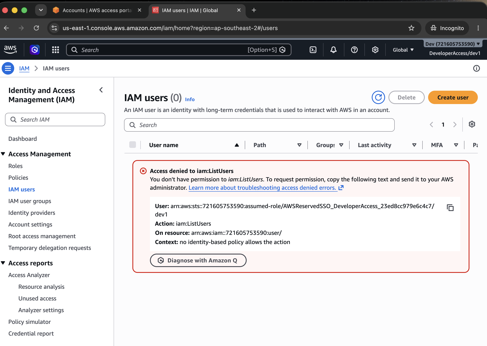
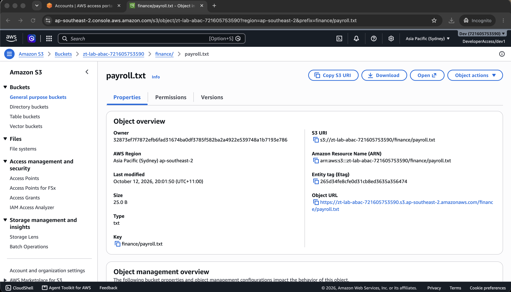
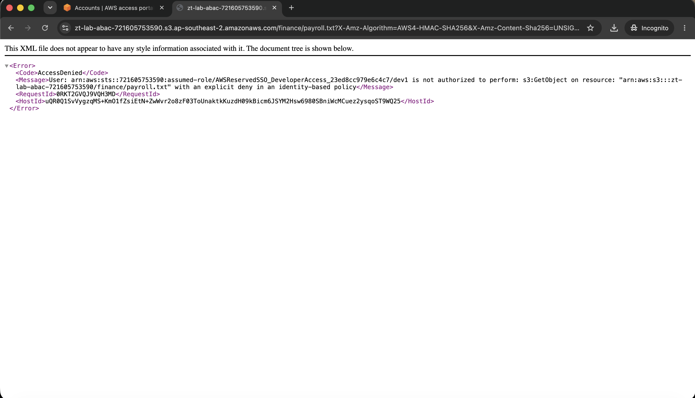
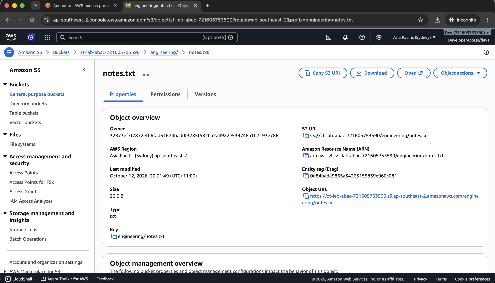

# AWS Zero Trust IAM Lab

A multi-account AWS environment built to demonstrate Zero Trust identity and access management: centralised identity, attribute-based access control, organisation-level guardrails, and automated remediation of non-compliant configurations.

Built by **Princewin Marti** — Master of IT (Cybersecurity), Macquarie University.

> **Status:** Phases 1 and 2 of 5 complete. This README is updated as each phase lands.

---

## The problem

Most cloud breaches don't involve breaking through a perimeter. They involve a valid credential doing more than it should. Traditional security treats the network boundary as the trust boundary — once you're inside, you're trusted.

Zero Trust inverts that: no implicit trust, verify every request, and grant the minimum access needed for the shortest useful time.

This lab implements that model on AWS and — more importantly — **produces evidence that the controls actually hold**.

---

## Architecture

```
                    AWS Organizations (feature set: ALL)
                                  │
                    ┌─────────────┴─────────────┐
                    │                           │
            Management account            Workloads OU
            ─────────────────         ┌───────────┴───────────┐
            · IAM Identity Center      │                       │
            · Service Control Policies │                       │
            · CloudTrail (org trail)  Dev account         Prod account
            · Central log bucket      ───────────         ────────────
                                      · Dev workloads     · Sensitive data
                                      · ABAC-tagged       · ABAC-tagged
                                      · Config rules      · GuardDuty
```

Identity lives in one place. Every account is reached by assuming a short-lived role — no long-lived IAM users in the workload accounts.

---

## Access model

| Group | Management | Dev | Prod |
|---|---|---|---|
| Admins | AdminAccess | AdminAccess | AdminAccess |
| Developers | — | DeveloperAccess | **none** |
| Auditors | — | AuditorAccess | AuditorAccess |

Two gaps are deliberate:

**Developers have no access to Prod at all** — not read-only, nothing. The account doesn't even appear in their portal.

**Only Admins reach the Management account**, since it holds the SCPs and organisation configuration. Access there is effectively access everywhere.

Permission sets are assigned to **groups, never to individual users**. Changing someone's access means moving them between groups rather than editing policy — which is what makes periodic access reviews tractable.

---

## Phases

| # | Phase | Status |
|---|---|---|
| 1 | Multi-account foundation | Complete |
| 2 | ABAC policy implementation | Complete |
| 3 | MFA enforcement & least privilege | Not started |
| 4 | Automated detection & remediation | Not started |
| 5 | Documentation & packaging | Not started |

### Phase 1 — Multi-account foundation

Three accounts under AWS Organizations with Dev and Prod grouped into a `Workloads` OU. Identity centralised through IAM Identity Center with three permission sets and a four-hour session duration. Organisation-wide CloudTrail with log file validation, writing to a bucket in the Management account.

**Scripts:** [`01-create-permission-sets.sh`](scripts/01-create-permission-sets.sh) · [`02-create-users-and-groups.sh`](scripts/02-create-users-and-groups.sh) · [`03-assign-accounts.sh`](scripts/03-assign-accounts.sh)

### Phase 2 — ABAC policy implementation

Identity Center maps a user attribute into the session as a principal tag. A policy then compares that tag against the resource's tag — no bucket or object names appear anywhere in the policy.

**Tagging strategy**

| Tag | Values | Purpose |
|---|---|---|
| `Department` | Engineering, Finance | Who owns the data |
| `Environment` | dev, prod | Where it lives |
| `DataClassification` | public, confidential | How sensitive |

**Policy:** [`developer-abac-boundary.json`](policies/developer-abac-boundary.json)

```json
{
  "Effect": "Deny",
  "Action": ["s3:GetObject", "s3:GetObjectTagging", "s3:PutObject", "s3:DeleteObject"],
  "Resource": "arn:aws:s3:::zt-lab-abac-*/*",
  "Condition": {
    "StringNotEquals": {
      "s3:ExistingObjectTag/Department": "${aws:PrincipalTag/Department}"
    }
  }
}
```

Three deliberate choices in those few lines:

**`Deny`, not `Allow`.** `DeveloperAccess` already carries `PowerUserAccess`, which permits S3 broadly — another `Allow` would change nothing. An explicit Deny overrides any Allow, so it is the only way to carve a hole in a permission already granted.

**No resource names.** The resource is a wildcard; authorization is decided entirely by tag comparison. New objects are covered the moment they are tagged, with no policy change. That is the practical argument for ABAC over RBAC.

**Untagged objects fail closed.** `StringNotEquals` evaluates true when the key is absent, so an object with no `Department` tag is denied by default.

---

## Findings

Evidence that the controls work. Screenshots in [`screenshots/`](screenshots/).

### Finding 1 — Cross-account boundary holds

Signed into the AWS access portal as `dev1`. Only the Dev account was listed. Prod and Management were **not visible at all** — the boundary removes them from view rather than showing them and denying on click.

### Finding 2 — Privilege escalation blocked

As `dev1` in the Dev account, attempted to list IAM users:

```
Access denied to iam:ListUsers
User:   arn:aws:sts::<dev-account>:assumed-role/
        AWSReservedSSO_DeveloperAccess_<id>/dev1
Action: iam:ListUsers
```

Two things worth noting in that error:

1. `PowerUserAccess` grants broad build permissions but **excludes IAM writes** — a developer cannot grant themselves more access.
2. The principal is an **`sts` assumed role**, not an IAM user. `dev1` holds no long-lived credentials in the Dev account; the role expires after four hours.



### Finding 3 — MFA required at first sign-in

Identity Center required MFA registration before `dev1` could reach any account.

This is Identity Center's own control and covers console sign-in. The organisation-level SCP added in Phase 3 covers **API and CLI calls as well**, and cannot be disabled by an account administrator. Two layers doing related but distinct jobs.

### Finding 4 — Tag mismatch denies access to one object but not another

Signed in as `dev1`, who carries `Department=Engineering` as a session tag. Both objects live in the same bucket, under the same permission set, governed by the same policy:

| Object | Object tag | Result |
|---|---|---|
| `engineering/notes.txt` | `Department=Engineering` | Downloaded successfully |
| `finance/payroll.txt` | `Department=Finance` | **AccessDenied** |

The only variable is the tag. Nothing in the policy refers to either file.

AWS names the cause in its own response:

```xml
<Error>
  <Code>AccessDenied</Code>
  <Message>User: arn:aws:sts::<dev-account>:assumed-role/
    AWSReservedSSO_DeveloperAccess_<id>/dev1 is not authorized to perform:
    s3:GetObject on resource: "arn:aws:s3:::zt-lab-abac-<id>/finance/payroll.txt"
    with an explicit deny in an identity-based policy</Message>
</Error>
```




### Finding 5 — Metadata remains visible to a denied principal

While `dev1` cannot read `finance/payroll.txt`, the object's properties page still renders: key, size, ARN, and last-modified date are all visible.

The deny covers `s3:GetObject` but not `s3:ListBucket`, so object existence and metadata leak to a principal that cannot read the contents. Whether that matters depends on the data — object keys alone can disclose a great deal. Closing it means extending the deny to `s3:ListBucket` with an `s3:prefix` condition, at the cost of a worse console experience.

Recorded here as an accepted finding rather than silently fixed, since the trade-off is a decision rather than an oversight.



---

## Design decisions

The reasoning, not just the steps.

**Workloads OU.** Dev and Prod are grouped so the MFA Service Control Policy attaches once at OU level rather than per account — and automatically covers any account added later. This is how guardrails are applied at enterprise scale.

**Four-hour session duration.** Shorter than the AWS default, so credentials expire within the working day they were issued and a stolen session token has a short useful life.

**PowerUserAccess for developers.** Broad build permissions, no IAM. Prevents self-escalation while staying out of developers' way. Verified in Finding 2.

**Single-region Identity Center.** Multi-region provisions a customer-managed KMS key at roughly $1/month plus replication charges, and addresses disaster recovery — not a concern for this environment.

**ABAC attribute sourced from `title`, not `enterprise.department`.** The Identity Store API rejects updates to `enterprise.*` attributes for users in the built-in directory — those fields are writable only for identities provisioned from an external IdP over SCIM. `title` is writable and is used as the source instead. The tag key the policy sees stays `Department`; only the source path would change when an external IdP such as Entra ID or Okta is connected.

**Organisation trail with log file validation.** `--is-organization-trail` covers every account including future ones. Logs land in the Management account, so a Dev account administrator cannot erase their own activity. `--enable-log-file-validation` produces signed digests proving logs weren't altered after the fact.

---

## Repository layout

```
.
├── README.md                  You are here
├── scripts/                   Provisioning scripts, run in numbered order
├── policies/                  IAM policy and SCP JSON
├── screenshots/               Evidence, organised by phase
└── docs/                      Build plan and supporting material
```

---

## Reproducing this

Requires an AWS account with permission to create an organisation, AWS CLI v2, and three unique email addresses (Gmail plus-addressing works: `you+dev@gmail.com`).

```bash
aws organizations create-organization --feature-set ALL

cp scripts/config.env.example scripts/config.env
# fill in your account IDs, instance ARN and identity store ID

./scripts/01-create-permission-sets.sh     # then copy the printed ARNs into config.env
./scripts/02-create-users-and-groups.sh    # then copy the printed group IDs into config.env
./scripts/03-assign-accounts.sh
```

All environment-specific identifiers live in `scripts/config.env`, which is gitignored. The scripts themselves contain no account IDs.

---

## Cost

Organizations, IAM, Identity Center, member accounts, and OUs are free. The CloudTrail organisation trail is free for the first copy of management events; S3 storage for logs is a few cents.

AWS Config and GuardDuty in Phase 4 are the only services with meaningful cost — a few dollars a month at this scale.

---

## Notes

Account IDs, ARNs and group IDs are redacted throughout. Nothing in this repository identifies the real environment — every environment-specific value lives in `scripts/config.env`, which is gitignored and never committed.

Account IDs are not secrets in the strict sense, but a confirmed, valid one is a usable starting point for role enumeration. Redacting them costs nothing.
